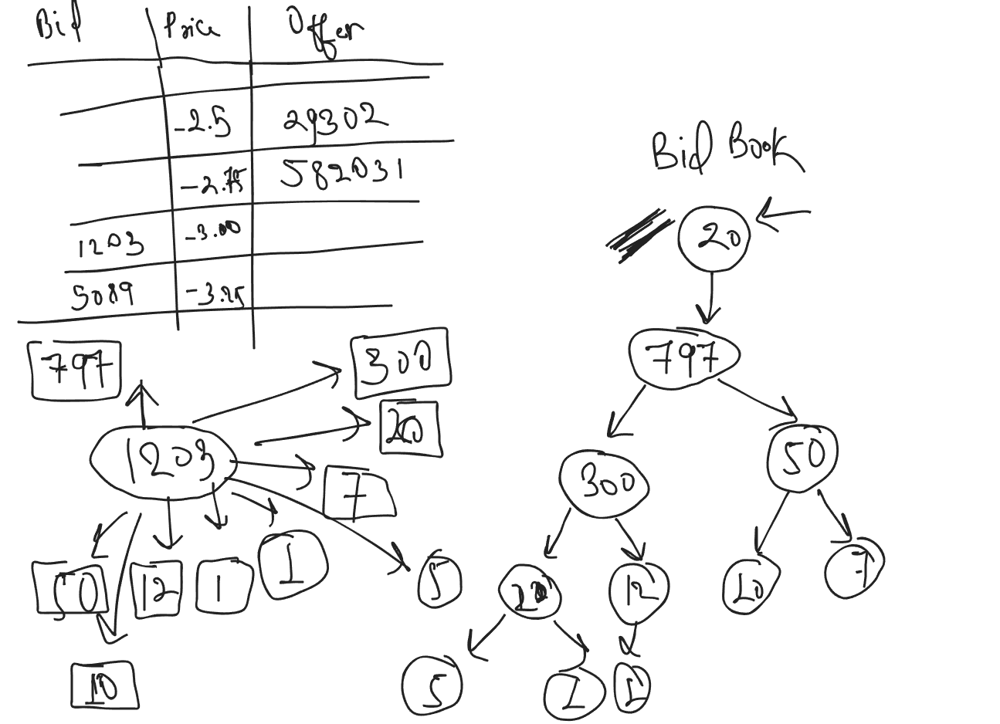
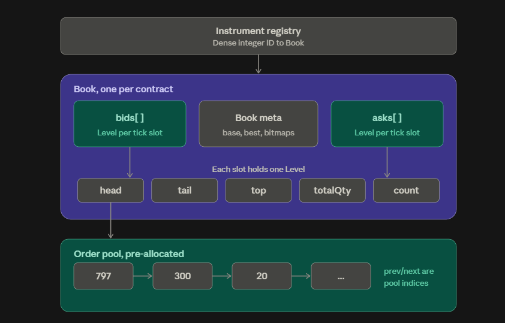
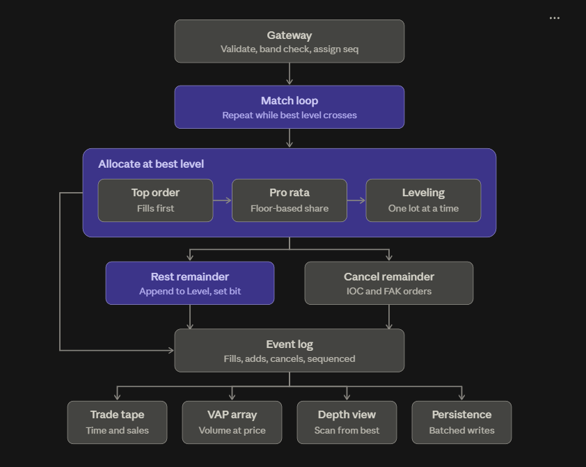

# Investify-v3 Matching Engine

## *Matching Algorithm:*
- The algorithm works to ensure equilibruim at all times in the market. By equilibruim I mean to say that the bid offer spread for every instrument remains positive at all times.
- An order placed on the exchange is first looked in for matching to the resting orders.
- A matched order, is allocated using the following the algorithm:
    - The first order placed on a price is seen as the top order, as is rewarded for price discovery, whenever an order is placed inside market, the top order is matched full at first, only then can other orders be matched.
    - The exchange also reward liquidity as the rest of the orders are matched based on pro-rata allocation, where the distribution of lots is given by the formula `floor((orderQty/totalRestingOrders)*Hitting)`.
    - The residual orders are matched based on leveling allocation where one lot is distributed at a time to every order.

## *Architecture and Design:*
- All instruments are given a numeric code and a product-ID, for example SR1 Dec26 - ZQ Dec26 Inter-Product is given the numeric code `200312` and product-ID `S1RFFV6` and SR3 Sep26-Dec26 Calendar is given the numeric code `1001226` and product-ID `S:SRASRAV6Z6`
- As an upgradation to Investify-v2, we do NOT create separate books for bids and offers, instead we create a single book storing the bids and offers as levels. The mechanics of this book will be discussed later in this readMe.
- The prices are stored as levels in an array for a faster lookup. For example, the FFR target is set in a 25 basis range, so for any instrument like SR1-ZQ, the prices can vary from -25.0 to 25.0. Assuming that each tick is 0.25 basis points we would need 200 indices to store all real orders. For instruments where the ranges are not defined, for example, commodities like wheat where prices could be anything, we have an admissible price range where orders can be placed, the range is decided by a dense sliding window and any orders beyond the range are inadmissable by the exchange. 
- The exchange maintains an `unordered_map` where `each instrument is stored as a key-value pair`. The value of every key is a struct node that stores the metadata for the instrument, which is basically: BestBid, BestAsk, BidBitMap, OfferBitMap, BaseTickRange, BidBook, OfferBook.
- The BitMap stores the index which contains atleast one resting bid/offer. This is to identify the best bid and best offer in O(1) time.

